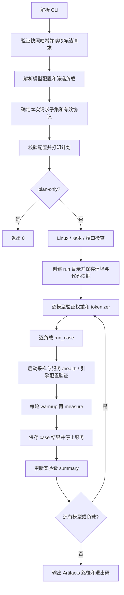

# benchmark.py 逐函数详解：目的、流程、原理与指标口径

分析日期：2026-10-23。依据当前源码，`benchmark.py` 共 633 行，16 个顶层函数，1 个类及其 5 个方法。

源码 SHA256：`a6b8923ee6d89cc16b63bfcd954c5932b35b83b32a7bb99d57a002b403f65128`。本文同步了阶段日志、NVTX和进程组退出逻辑；本次没有执行GPU benchmark或加载模型。

入口源码：[benchmark.py](../scripts/benchmark.py)。函数行号均对应上述版本；后续修改后应重新核对。

## 1. 脚本要解决什么问题

它把一次模型性能实验组织成可核对的执行过程：

1. 读取已经冻结的输入 token ID、生成长度和协议。
2. 解析 BF16、AWQ、官方 FP8、本地 FP8 的部署配置。
3. 检查权重身份、基础 tokenizer、运行环境和服务启动参数。
4. 为每个模型/负载启动一个独立 vLLM 服务。
5. 先预热，再发固定长度的流式请求，记录每请求原始结果。
6. 汇总成功率、吞吐、延迟分位数和整卡显存采样峰值。
7. 保存实验依据与错误，关闭本次创建的进程组。

设计目标是让模型比较尽量满足“相同输入、相同输出长度、相同生成参数、可追溯的运行配置”。它管理服务和客户端；真正的 GPU 计算由另外启动的 vLLM API/worker 进程执行。

它不执行量化转换，不做质量评分，不自动运行 Nsight，也不检查 `.nsys-rep` 是否完整。`passed` 是本脚本的请求/协议验收结果，不代表 kernel、性能提升或 profiler 数据已经验收。

## 2. 先认清四个数据对象

| 对象 | 代表什么 | 来源 | 关键字段 |
| --- | --- | --- | --- |
| config | 一个模型的部署与服务参数 | configs/*.yaml、自定义 JSON 配置、命令行覆盖 | profile、model、tokenizer、dtype、quantization、enforce_eager、fp8_backend、port |
| protocol | 本次实际执行的负载协议 | 冻结 workloads.yaml，加 requests/rounds 覆盖 | cases、requests、warmup、rounds、concurrency、seed |
| item | 一个冻结请求 | 冻结 requests.jsonl | id、case、phase、prompt_token_ids、input_tokens、output_tokens |
| model / identity | 本次选中的权重身份 | verify_model() 读取、哈希并验证 | config、files、quant_method、tokenizer_sha256、base_source_verification |

注意同名 `args`：main() 中是 argparse 命令行结果；client_args() 返回的 args 是给 HTTP Client 使用的小对象。`phase` 也同时出现在函数名和阶段字符串中，应按上下文区分。

配置文件虽然叫 `.yaml`，本项目实际用 `json.loads()` 读取，内容是 JSON 格式，不能直接改成任意 YAML 语法。

### 2.1 默认值到底来自哪里

当前仓库的四个模型配置均默认：dtype=bfloat16、enforce_eager=true、GPU memory utilization=0.75、max_num_seqs=1、max_num_batched_tokens=2048、端口7081、采样间隔0.5秒。

但负载协议来自 `data/frozen/workloads.yaml`，而不是每次重新读取 `configs/workloads.yaml`。当前冻结快照为 requests=200、warmup=5、rounds=1、concurrency=1；benchmark CLI 默认又将 requests 覆盖为50、rounds覆盖为1。

因此：

```text
冻结快照有 200 个正式请求可用
benchmark 不传 --requests       -> 实际选前 50 个
benchmark --requests 80         -> 实际选前 80 个
benchmark --requests 1          -> 实际选前 1 个，仍有 5 次预热
benchmark --requests 201        -> 拒绝，快照容量不足
```

修改 configs/workloads.yaml 不会自动改变已有冻结快照。当前 CLI 也没有单独的 --warmup、--concurrency 或 --port；这些分别来自冻结协议和模型配置。

## 3. 总体执行流程



推荐阅读顺序：`main()` → `run_case()` → `phase()` → `perform()`，再读配置/验证函数，最后读 GPURecorder 和小工具函数。

### 3.1 循环层级与服务生命周期

主循环相当于：

```python
for model in selected_models:
    verify_model_once(model)
    for case in selected_cases:
        start_a_fresh_server(model, case)
        for round_id in range(1, rounds + 1):
            run_warmup_requests()
            run_formal_requests()
        stop_this_server()
```

模型之间顺序运行；负载之间也顺序运行。不同 case 会重新加载服务，同一个 case 的多轮复用该服务；每轮仍重新预热。并发只发生在一个 phase 内的 HTTP 请求线程中。

若模型数=M、负载数=C、轮数=R、每轮预热=W、正式=N：

```text
启动服务次数             M × C
实际请求总数             M × C × R × (W+N)
正式请求总数             M × C × R × N
selected_requests.jsonl  C × (W+N) 行
```

selected_requests.jsonl 不为模型和轮次重复存相同请求。本次子集在各模型/轮次复用，实际请求记录靠 model_profile、round、phase、id 区分。

四模型×五负载×一轮×(5+50)，正常完整执行为20次服务启动、1100次请求，其中正式1000次。一次只选一个模型、一个负载、requests=1，则是1次启动、6次请求。

## 4. 参数解析与配置函数

### 4.1 positive_int(value)，496–500行

argparse 的类型转换器，把字符串转成 int，并拒绝小于1的值，用于 --requests 和 --rounds。格式错误也会经 argparse 报参数错误；不会默默把0改成默认值。

### 4.2 boolean_value(value)，503–509行

接受忽略大小写和首尾空白的 true/false、1/0，返回 Python bool；其它字符串报错。不能直接用 bool("false")，因为非空字符串在 Python 中会变成 True。

### 4.3 load_configs(args, source_model)，264–311行

输入：CLI 参数、冻结 BF16 源模型元数据。输出：本次模型 config 列表。

有 --config 时，读取自定义文件；未写 profile 时，依次尝试模型别名/目录名、quantization 声明、模型 config.json 推断。没有 --config 时，从模型 profile 选择对应配置文件，fp8-local 对应 fp8.yaml；默认只选择 BF16，--all-models 的顺序是 BF16、AWQ、官方FP8、本地FP8。

随后：

1. 将 fp8-origin 等别名规范化，展开模型路径。
2. 为量化模型补充冻结 BF16 源 tokenizer，确保直接发送的 token ID 在同一词表下解释。
3. CLI 指定 eager 或nvtx时覆盖配置；未指定时保留配置原值，nvtx缺省补false。
4. FP8 模型补默认 backend=auto，若有CLI backend则覆盖。
5. 调用 fp8_backend_environment() 检查环境冲突；这里返回值没有赋回，不会改父进程环境。实际子进程环境在 run_case() 中构造。
6. 拒绝重复的规范化模型选择，以及只选非FP8模型却请求 Marlin。

两个易错点：

- --model 用于本脚本支持的 profile/别名，任意新模型目录应通过 --config 指定。
- 普通 --model 路径中，读完 YAML 后会把 model 字段更新为 profile 对应的别名展开结果；其根目录可由 MODEL_ROOT 控制。只修改默认 YAML 的 model 字段，不保证改变该路径；自定义 --config 会保留显式模型目录。冻结source_model.path也是保存的绝对路径，迁移模型目录时只改MODEL_ROOT不会自动迁移它，量化模型的tokenizer应显式核对。

### 4.4 validate(config, protocol, model=None)，208–237行

分两次使用：执行前只查 config/protocol；verify_model 后再带 actual model.config 检查格式和运行参数。

它要求：

| 项目 | 实际约束 | 目的 |
| --- | --- | --- |
| BF16基线 | bfloat16，quantization为None或auto | 防止基线误用量化权重/精度 |
| eager | 必须是bool，而不是"false"字符串 | 避免配置真假歧义 |
| FP8 backend | auto，或FP8模型使用marlin | 限定受支持的后端请求 |
| 缓存/模板 | prefix caching和thinking禁用 | 减少跨请求缓存和模板差异 |
| KV dtype | 仅允许auto | 不混入独立KV量化变量 |
| 计数 | requests≥1、warmup≥5、rounds≥1、concurrency≥1 | 确保阶段有有效请求 |
| 生成参数 | seed=42、temperature=0、ignore_eos、定长输出 | 约束比较协议 |
| 调度并发 | max_num_seqs≥客户端concurrency | 避免服务容量小于客户端请求并发 |
| 显存/采样 | 0<utilization≤1，采样间隔>0 | 拒绝无效运行设置 |

这不是所有 vLLM 参数的完整验证，也不是 GPU kernel 可用性验证。具体硬件和加载支持还要到服务启动时检查。

### 4.5 select_requests(items, snapshot_protocol, cases, requests=50, rounds=1)，240–261行

从冻结数据中选确定性前缀，不修改原快照：

1. 复制冻结 protocol，覆盖本次 requests 和 rounds。
2. 每个 case 分别取 warmup、measure；按字符串 id 排序。
3. 检查完整冻结组的数量与ID唯一性，检查输入token长度和目标输出长度。
4. 取每组前 count 条；请求数超过快照容量时失败。
5. 对所选列表作键排序、紧凑JSON序列化，再计算 SHA256。

同样的请求选择得到同样的子集指纹，但 rounds 不参与所选请求列表的复制，因此仅改轮数通常不会改变 subset SHA。模型选择也不进入该指纹。它描述请求内容/顺序，不单独描述整个实验；须结合 run.json 的轮次、配置一起解释。

case顺序仍来自冻结cases列表，--case只是筛选，不按CLI参数出现顺序重排。请求id按字符串排序，本项目使用零补齐编号保证顺序清楚。

## 5. 模型身份与运行环境验证

### 5.1 verify_model(config, source_model)，314–363行

输出模型 identity，并可能修改 config 中的 dtype、quantization，使其与解析后的实际格式匹配。

执行步骤：

1. 读实际模型 config.json，验证所选 profile 与量化格式一致，检查 backend 请求。
2. resolve_runtime_options() 确定 dtype/quantization，并更新 config。
3. 确认目录下有 safetensors 或 bin 权重。
4. 对该目录顶层的 .safetensors、.bin、.json、.jinja、.txt 文件逐一做SHA256。
5. BF16：要求冻结源模型已记录的文件哈希逐一匹配。
6. 量化模型：比较 model_type、hidden_size、层数、头数、rope等架构字段；不拿量化权重哈希与BF16权重强行比较。
7. 对显式基础tokenizer目录中的冻结参考文件核验哈希，防止换词表/模板。
8. 本地FP8若有 quantization_manifest.json，进一步验证状态complete、源哈希匹配冻结BF16、输出哈希匹配当前产物。

身份可信度有区别：

| base_source_verification | 表示什么 |
| --- | --- |
| exact_frozen_files | BF16与冻结文件一致 |
| architecture_only; original base revision unproven | 量化模型架构匹配，未证明它来自同一原始revision |
| conversion_manifest_matches_frozen_source | 本地量化清单与冻结源及当前输出匹配 |

本地FP8转换清单存在时必须一致，但当前代码不强制所有本地FP8都带清单；没有清单时不会自动获得第三种来源证明。

文件哈希固定本地内容，不等于证明官方发布来源；官方FP8 profile也是部署标签和格式约束，不能仅凭名称证明发布方身份。本函数不把权重tensor加载到GPU，不进行数值质量比较。

### 5.2 check_runtime_versions()，481–493行

用 importlib.metadata 读取安装版本，当前只接受两套完整组合：

| 组合 | torch | transformers | vLLM | compressed-tensors |
| --- | --- | --- | --- | --- |
| legacy-cutedsl | 2.8.0+cu129 | 4.57.6 | 0.11.0 | 本函数不额外核验 |
| unified-quantization-inference | 2.9.1+cu128 | 4.57.3 | 0.14.1 | 必须0.13.0 |

这是项目当前源码的白名单，不是对这些库所有版本的兼容性结论。main() 还要求显式 FP8 Marlin及NVTX worker使用0.14.1。这里只读取包元数据，不在benchmark父进程导入torch并初始化CUDA。

### 5.3 verify_engine(startup, config, model)，366–389行

从 server.log 找最后一条同时包含“LLM engine”和“config:”的初始化日志，用正则提取dtype与quantization，再与期望值比较。

quantization=auto时，期望值来自真实权重config的quant_method。AWQ-Marlin等显式请求则按解析后的config核对，比较时统一下划线/连字符。

FP8 backend=marlin时，还要求启动日志包含“leveraging the Marlin kernel”，记录 W8A16 与初始化验证来源。始终保留 cuda_kernel_verified=False。

它证明启动日志中的引擎设置符合预期，不证明每个实际kernel是什么；也没有在这里核验Graph回放、enforce_eager实际配置或所有调度参数。日志格式变了可能验证失败，即使服务已经能健康响应。

## 6. 请求构造、并发和指标汇总

### 6.1 now()，30–31行

返回带UTC时区的ISO时间，用于 submitted_utc、run.started、GPU采样时间等人可读记录。

计时使用perf_counter()/monotonic()；UTC时间用于关联日志，不直接用于计算请求耗时，避免系统时间校准影响duration。

### 6.2 client_args(config)，73–75行

将服务配置转换为Client需要的SimpleNamespace：

```python
base_url = f"http://127.0.0.1:{config['port']}"
timeout = config['request_socket_timeout_seconds']
api_key_env = 'VLLM_API_KEY'
no_proxy = True
```

服务可以监听0.0.0.0，benchmark仍从本机loopback访问。Client显式禁用代理，并从环境取API Key。timeout传给urllib/socket，不是脚本额外实现的严格总请求墙钟截止时间。

### 6.3 perform(args, config, item, round_id, phase)，126–182行

作用：完成一个请求，返回一条可写入JSONL的entry，而不是直接写文件。

先记录id、case、model_profile、round、phase、UTC和单调时钟起点，默认ok=False；随后构造payload：

```json
{
  "model": "local-model",
  "prompt": [123, 456],
  "max_tokens": 128,
  "min_tokens": 128,
  "ignore_eos": true,
  "temperature": 0,
  "top_p": 1,
  "top_k": -1,
  "repetition_penalty": 1,
  "seed": 42
}
```

上面的token数组只是示意；实际prompt直接使用冻结的完整prompt_token_ids。

固定min/max输出长度并忽略EOS，是为了避免某模型提前结束、输出更短而显得更快。temperature=0及其它固定生成参数用于限制采样变量；固定seed不等于跨硬件/实现逐bit完全可复现。

调用是：

```python
Client(args).stream_chat(payload, path='/v1/completions')
```

虽然方法名叫stream_chat，这里显式使用的是completions端点。它发送已经渲染、已经分词的token IDs，不在服务端重新套聊天模板。thinking=False主要通过冻结阶段的enable_thinking=False模板生成与本次协议检查落实，不是这个payload里再传一次thinking开关。

Client会补stream=True、include_usage=True，解析SSE、文本、usage和中间件profiling事件，并要求完整的[DONE]/choices/finish_reason。

收到结果后，本函数还有三类验收：

1. usage.prompt_tokens必须等于冻结input_tokens。
2. usage.completion_tokens必须等于固定output_tokens。
3. server_metrics必须有数值inference_seconds、一致的输入输出token数、非None的output_tokens_per_second。

HTTP 200不等于本脚本成功；长度不符或profiling指标缺失，都会保持ok=False。Client成功后才在后续验收失败的entry，仍可能保留result，便于追查。

普通异常在此转为error和failure_kind；最后记录finished_monotonic、外层elapsed_seconds，对entry中的API Key做替换脱敏，再返回。这里没有自动重试请求，失败会被保留。

### 6.4 phase(args, config, items, round_id, phase_name, concurrency, output)，185–205行

作用：执行一个warmup或measure阶段，并聚合阶段统计。

```text
建立ThreadPoolExecutor(max_workers=concurrency)
    ↓
为每个item提交perform任务
    ↓
as_completed按完成顺序取结果
    ↓
追加到entries和requests.jsonl
    ↓
用所有请求的起止时间求阶段跨度
    ↓
summarize_requests + TTFT/TPOT分位数
```

为什么用线程：客户端主要等待HTTP/SSE，线程能够同时保持多个请求在途；它不负责在Python线程中并行做GPU矩阵计算。所有模型/负载仍然串行切换。

phase假定items非空，否则max/min无法计算；正常调用由请求筛选和validate保证。请求一次全部提交到线程池，但同时执行数最多为concurrency，其余在本地队列等待。单请求的perform起点在worker开始执行时，所以不会把进入线程池前的排队时间计入该请求的elapsed。这不是按固定QPS到达的开放环压测，也没有自定义到达间隔。

as_completed意味着JSONL按完成顺序写，不能假定文件行号就是提交顺序；应按id、round、phase定位。实际请求并发为1时通常与请求顺序一致。

阶段跨度：

```text
wall_seconds = 最晚 finished_monotonic − 最早 started_monotonic
```

包括失败请求占用的时间，也包括首末请求之间的空隙。不含模型加载、阶段之前的预热或最后请求之后的日志落盘时间。

代码写的timing_scope是first_submit_to_last_finish，但起点实际在perform()内部。更准确的解释是“首个请求worker开始执行，到最后请求worker结束”，不是主线程调用pool.submit()的精确时刻。

成功率、吞吐和E2E分位数委托给summarize_requests；本函数再对成功请求计算客户端TTFT文本事件和TPOT文本事件的p50/p95。warmup和measure分别统计，不混在同一吞吐分母里。

## 7. GPURecorder：5个方法分别做什么

它是一个上下文管理器：`with GPURecorder(...)`进入时开始采样，离开时停止后台线程。

| 方法 | 行号 | 职责 |
| --- | --- | --- |
| __init__(path, interval) | 34–39 | 保存路径和间隔，phase=before_load，建立停止Event、内存samples列表和daemon线程 |
| sample() | 41–55 | 调nvidia-smi，解析整卡显存/利用率，追加内存列表和gpu.jsonl；查询/解析错误保存为error |
| run() | 57–59 | 等待interval后采样，直到stop Event被设置 |
| __enter__() | 61–64 | 立即采样一次，再启动后台线程，返回self |
| __exit__() | 66–68 | 设置stop，join最多7秒；返回None，不吞掉外层异常 |

sample()的查询：

```bash
nvidia-smi --query-gpu=uuid,name,memory.total,memory.used,memory.free,utilization.gpu --format=csv,noheader,nounits
```

采集是整卡视角，不是vLLM进程的allocator峰值，也不单独识别权重、KV cache、workspace。没有-i参数，所以查询nvidia-smi可见的设备，不能假定它只对应torch当前使用的那张卡。

phase标签依次可能是：

```text
before_load
loading
loaded
round_1_warmup
round_1_measure
round_2_warmup
round_2_measure
...
```

主线程修改phase，后台线程将当前标签写入采样。不是精确的GPU阶段边界，也不是NVTX范围。interval=0.5表示每次采样之后再等待约0.5秒，实际采样周期还包含nvidia-smi耗时；不能视为严格2Hz。

瞬时峰值可能落在两个采样点之间。采样失败不会立刻终止HTTP阶段；run_case最后只有在完全没有任何有效显存采样时才额外把case标为failed，并没有保证每个阶段都有有效采样。

## 8. 服务启动与退出

### 8.1 launch_command(config, case)，106–123行

返回字符串列表，交给Popen直接执行，不通过shell拼接。使用sys.executable确保run_model.py使用与benchmark相同的Python解释器。

核心参数：

| 参数 | 来源/目的 |
| --- | --- |
| --serve --backend vllm | 使用项目的vLLM服务包装入口 |
| --model、--tokenizer | 本次模型权重和共享基础tokenizer |
| --dtype、--quantization | 激活/非量化部分dtype和权重加载格式 |
| --max-model-len | case.input_tokens + case.output_tokens |
| --gpu-memory-utilization | 传递vLLM内存分配设置，不是测得峰值或性能指标 |
| --max-num-seqs | 服务调度并发容量 |
| --max-num-batched-tokens | 调度token预算；不会直接改变固定输入/输出长度 |
| --seed 42 | 固定引擎随机种子 |
| --enforce-eager / --no-enforce-eager | 将bool配置传给包装入口 |
| --fp8-backend | 仅FP8模型显式传递auto/marlin |

w128_o128对应max_model_len=256；w8192_o128对应8320。输入长度大于max_num_batched_tokens时，由服务包装层启用的chunked prefill处理，不能把2048误解成最大支持输入长度。

run_model.py还会：关闭prefix caching，启用chunked prefill，加载ProfilingMiddleware，要求usage，设置generation-config=vllm，并启动vLLM的OpenAI API服务。eager=False时它不向vLLM追加enforce-eager强制标志，允许框架按配置使用Graph，不能保证所有计算都进入Graph。

### 8.2 run_case(config, protocol, case, items, directory, model)，392–478行

这是“一个模型×一个负载”的完整生命周期，返回case record。

执行顺序：

1. 创建`实验目录/profile/case/`；记录初始status=incomplete、命令和选项。
2. 建立GPURecorder和本地HTTP客户端参数。
3. 进入`with gpu, server.log`，先记录before_load采样，再切换loading。
4. Popen启动run_model.py，stdout/stderr都写server.log，start_new_session=True；传入隔离的FP8后端环境。
5. 循环检查包装子进程是否提前退出，并访问/health；探测请求timeout=2秒，失败后每秒重试，直至启动超时。
6. 服务健康后读取server.log，调用verify_engine。
7. 切换loaded，等待max(1秒,2×采样间隔)。
8. 每轮先warmup再measure，每个phase后把结果追加到record.rounds，写summary.json，打印成功/总数。
9. 若warmup有失败，立即终止该case，不开始这一轮正式phase；若measure有失败，记失败但不在这里立即中断后续轮次。
10. 所有阶段均无失败时先设passed，否则failed。其它普通异常由except记录到case。
11. 离开with时停止采样；finally调用stop_process，按phase+UUID求used_mib最大值，写最终case summary。

`record['rounds']`名字容易误导：它存的是phase结果。2轮会有4条：warmup1、measure1、warmup2、measure2；不能直接把len(rounds)当成正式轮数。

三个线程/进程关系：

```text
benchmark.py
  ├─ GPURecorder后台线程 -> 周期启动nvidia-smi
  ├─ ThreadPoolExecutor线程 -> HTTP/SSE请求
  └─ run_model.py子进程，新的session/process group
       └─ vLLM API服务进程
            └─ EngineCore / GPU worker等
```

GPURecorder在with退出时已停，stop_process在后面的finally才执行，因此gpu.jsonl不覆盖完整关闭/释放显存阶段，不能用于还原after_unload峰值。

run_case只有普通请求/服务错误被捕获；finally中的stop_process或写文件自身若抛出异常，仍可能向上冒泡，不能认为“任何失败都必然保存完整最终summary”。

### 8.3 stop_process(process)，78–103行

目标是清理本次Popen创建的进程组，同时保留worker关闭时间：

```text
process is None -> 直接返回
SIGTERM发送到PGID=process.pid的进程组
最多15秒：poll回收包装进程，同时killpg(pgid, 0)检查整个组是否退出
组提前消失 -> 结束等待；包装进程先退出但worker还在 -> 继续等待
到期仍存在 -> 记录shutdown_escalation，再SIGKILL本次组
wait直接子进程，最多10秒
```

start_new_session=True使直接子进程成为新session/进程组的leader，通常PGID等于该PID。killpg作用于组内成员，不是按模型名扫描或杀掉其它已有服务，也不能保证清掉主动脱离该进程组的所有后代。

Popen持有的是run_model.py包装进程，不是GPU worker。新版不再把包装进程退出视为整个组已退出，避免随即强杀仍在收尾的worker；shutdown_start/end及升级信号写入events.jsonl。是否丢事件仍需看采集警告和GPU覆盖检查。

nsys的wait=all独立控制采集器等待子进程；该函数仍没有显式cudaProfilerStop或GPU同步，不能把进程组清理完成等同于采集数据完整。外层run_case新增controller/shutdown范围。

## 9. main(argv=None)：完整控制流程，513–629行

main负责连接前面所有函数。它本身不实现HTTP解析或量化kernel。

### 9.1 参数解析

| 参数 | 默认/行为 |
| --- | --- |
| --snapshot | ROOT/data/frozen；ROOT是quantization_profiling项目目录 |
| --config | 自定义单模型配置，与--model/--all-models互斥 |
| --model | 可重复，选择受支持的profile；未选模型时默认BF16 |
| --all-models | 四模型按PROFILE_NAMES顺序执行 |
| --requests | 每模型/负载/轮的正式请求数，默认50 |
| --rounds | 每模型/负载轮数，默认1 |
| --case | 可重复；不传时运行冻结协议全部负载 |
| --enforce-eager | 可裸用表示true，也接受true/false/1/0；默认None保留配置 |
| --no-enforce-eager | 覆盖为false，与前一个参数互斥 |
| --fp8-backend | auto/marlin；默认None保留配置 |
| --nvtx / --no-nvtx | 覆盖本次NVTX配置；默认保留配置，内置配置默认关闭。GPU worker标记仅支持0.14.1 |
| --plan-only | 验证快照和基本配置，打印计划后退出 |

### 9.2 准备计划

```text
load_snapshot
    -> source_model = read(snapshot/model.json)
    -> load_configs
    -> 筛选cases并拒绝未知ID
    -> select_requests
    -> validate(config, protocol)
    -> 打印JSON计划
    -> plan-only则return 0
```

打印计划发生在verify_model和verify_engine之前。此时model_verification仍为pending，计划中的命令还可能在实际模型格式解析后发生规范化调整。

plan-only不会启动服务、完整哈希模型权重、检查GPU、检查固定软件栈或验证实际kernel。它需要可用且哈希一致的快照；自定义配置若需要从真实config.json推断profile，仍可能访问模型目录，不能理解成完全不访问模型文件的模式。

### 9.3 运行前检查

正式执行限定Linux；Windows可用plan-only查看计划。随后检查包版本、Marlin/NVTX worker的版本限制；启用NVTX时验证可选依赖，再尝试bind每个配置的端口。plan-only不要求安装nvtx。

bind成功后立即关闭socket，只证明那一刻端口可绑定，不是持续占用该端口的锁。这里没有自动等待端口、复用已有服务或停止外部服务；前面quickstart里的wait_7081是脚本外的辅助逻辑。

### 9.4 创建实验与保留依据

实验ID为UTC时间戳加8位随机十六进制尾缀，目录为ROOT/log/benchmark_<run_id>。

依次保存run.json、selected_requests.jsonl；运行collect_environment.py，读environment.json，并要求至少能看到一张支持BF16的RTX 4090D。此门槛是本项目硬编码目标，不是任意GPU都允许的通用benchmark入口。

该检查不自动将服务绑到某张卡；实际可见/使用设备仍受继承的环境等因素影响。GPURecorder也不会自动按这个检查筛选显存采样。

然后保存脚本SHA、git commit/工作区状态和pip freeze。git两条命令没有check=True，执行失败时内容可能为空，不能保证code.json中总有有效commit。

### 9.5 真正执行模型和case

逐模型verify_model并二次validate。若模型预检失败，给该模型所选每个case写failed/model_precheck记录，不启动服务，仍继续处理后面的模型。

模型预检通过则逐case调用run_case。每完成一个case更新实验级summary.json，保留已完成结果。run_case里的普通失败通常转成record，允许主循环继续；但未被捕获的IO/清理异常仍可能中断。

模型权重哈希是每个模型一次，服务启动是每个模型/负载一次；不要把二者混同。

### 9.6 最后退出

输出Artifacts路径后，只有results非空且所有case的status都为passed才return 0，否则return 1。文件底部raise SystemExit(main())将返回值变成进程退出码。

| 情形 | 常见结果 |
| --- | --- |
| plan-only正常 | 0 |
| 所有case通过 | 0 |
| 正常收集到了失败case，或目标GPU预检失败 | 1 |
| argparse/p.error：非法参数、未知case、非Linux正式运行等 | 2 |
| 快照损坏、版本异常、环境采集失败、IO/清理异常等未被上层捕获 | 可能直接traceback，通常非0，未必有完整summary |

Artifacts表示结果存放位置，不是成功标识；退出码0也不代表Nsight数据完整，因为脚本并不验收profiler输出。

## 10. 指标的计算原理

### 10.1 四层计时，不能混用

| 层级 | 起止位置 | 用途 |
| --- | --- | --- |
| phase wall_seconds | 最早perform开始→最晚perform结束 | 阶段吞吐分母，包含失败与阶段内部间隔 |
| entry.elapsed_seconds | perform开始→验收/错误处理完成 | 请求包装层耗时，包含Client构造及后置验收 |
| result.client_metrics.end_to_end_seconds | Client.stream_chat内部开始→消费完SSE | 客户端HTTP E2E，含网络、服务等待及响应处理 |
| result.server_metrics.inference_seconds | 中间件收到请求→生成末尾profiling事件 | 服务端请求墙钟，含排队/处理/生成/背压 |

Client E2E不包含外层Client对象构造和后置token校验，因此不必与entry.elapsed_seconds完全相同。服务端inference_seconds不是CUDA Event测得的纯GPU计算时间。

### 10.2 吞吐与成功率

由test_server.summarize_requests()计算：

```text
T                 = 阶段wall_seconds，包含失败
successful_tokens = 成功请求usage.completion_tokens之和
输出吞吐           = successful_tokens / T
请求吞吐           = 成功请求数 / T
错误率             = 失败请求数 / 总请求数
```

例如10个正式请求，9个成功，每个成功输出128token，整个阶段耗时30秒：输出吞吐为1152/30=38.4 token/s，请求吞吐为9/30=0.3 req/s，错误率10%。失败请求占用的时间仍在30秒分母里，不能删掉后重新报告更高吞吐。

总token数来自服务usage，不以文本字符数或SSE chunk数代替。若usage不完整会被perform拒绝；通用summarize_requests也会将不完整的token统计标记为不可用。

### 10.3 E2E p50/p95

仅从ok=True的请求取client E2E，使用nearest-rank方法：排序后取第ceil(n×p)个值，使用0起始索引时减1。

- n=80时，p95取排序后第76个。
- n=1时，p50与p95都是唯一请求值，不能反映尾延迟分布。
- 所有请求失败时，延迟分位数为None；失败数和阶段跨度仍保留。

吞吐分母含失败，而延迟分位数仅取成功请求；读报告时必须同时看成功率。

### 10.4 TTFT与TPOT文本事件近似

Client.stream_chat忽略无文本的控制/usage事件，记录首个和最后一个非空文本事件的时刻：

```text
TTFT文本事件 = 首个非空文本到达 − 客户端计时起点
TPOT文本事件 = (最后文本到达 − 首个文本到达) / (输出token数 − 1)
```

不是按text_chunks−1作为分母。SSE一个事件可能包含多个token，网络/服务端可能缓冲，因此只是近似。若所有文本被一起发送，首末事件时间接近，TPOT可能很小；这不证明GPU每token耗时很小。

phase只聚合成功且该项非None的值。它们包含客户端可见的排队和网络影响，不能直接称为GPU prefill/decode latency。

### 10.5 显存峰值

run_case对每条有效采样使用：

```text
key = phase + ':' + GPU_UUID
peak[key] = max(该阶段该设备所有sample.used_mib)
```

是整卡的采样峰值，包含其它进程、vLLM缓存预留和运行开销，可能漏掉瞬时峰值。gpu_memory_utilization=0.75是传给服务的配置，不是测出来的峰值，也不是脚本执行了“实测峰值必须≤75%”的验收。

## 11. 输出文件为什么这样组织

```text
log/benchmark_<run_id>/
├── run.json                    本次有效协议、原冻结协议、模型身份与配置
├── selected_requests.jsonl     实际请求子集，便于复核/复用
├── environment.json            目标环境采集结果
├── environment.log             环境采集stdout/stderr
├── code.json                   脚本哈希、git commit、工作区状态
├── pip-freeze.txt              包版本列表
├── summary.json                实验级case状态列表，逐case更新
└── <profile>/<case>/
    ├── server.log              run_model/vLLM/worker启动与错误日志
    ├── gpu.jsonl               带phase和UUID的整卡采样
    ├── requests.jsonl          每个实际请求的原始entry，含round/phase
    └── summary.json            本case的各阶段统计、引擎验证、显存峰值
```

完整性链条：冻结manifest检查输入文件；subset SHA确定实际请求；selected JSONL留原文；权重/tokenizer哈希确定本地内容；run/code/environment确定运行依据；逐请求JSONL支持重算；两级summary用于查看结果。

它不是带数字签名的来源认证系统，也不是自动把所有外部依赖与GPU内核完整归档的系统。JSON写入使用write_text而非原子替换，异常中断可能留下未完成文件；原始请求与已完成case记录仍是排查依据。

## 12. 被导入的辅助函数，职责在哪里

这些函数不定义在benchmark.py，但影响它的行为：

| 模块/函数 | 在本脚本中的用途 |
| --- | --- |
| experiment_utils.ROOT | quantization_profiling项目目录，默认配置/日志路径依据 |
| digest | 分块SHA256文件内容，避免把大权重整体读进内存 |
| read/write | 读JSON、创建父目录并写JSON |
| load_snapshot | 校验manifest列出的全部文件，再读请求与冻结协议 |
| write_rows | 保存本次选中的请求JSONL；在main内部导入 |
| failure_kind | 按错误文本粗分oom、kv_capacity、timeout、rejected、missing_metrics、error |
| test_server.Client | urllib HTTP与SSE客户端、usage/profiling解析 |
| summarize_requests | 阶段成功率、吞吐、E2E分位数 |
| percentile | nearest-rank分位数，空值返回None |
| redact | 递归替换本次API Key，不改变统计含义 |
| canonical_profile / profile_from_model_name | 规范化选择标签或从别名/目录名推断profile |
| resolve_model_alias | 按MODEL_ROOT展开已知模型别名，显式路径保留 |
| inspect_model_config / quant_method | 从真实config识别非量化、AWQ或FP8格式 |
| validate_model_profile | 核对部署标签与实际格式；官方FP8有特定metadata约束 |
| resolve_runtime_options | 选择匹配该checkpoint的dtype与量化加载选项 |
| validate_fp8_backend | 拒绝不受支持的显式FP8 Marlin请求 |
| fp8_backend_environment | 复制父环境，为子进程显式设置force-Marlin变量并查冲突 |

进一步源码：[experiment_utils.py](../scripts/experiment_utils.py)、[test_server.py](../scripts/test_server.py)、[model_profiles.py](../scripts/model_profiles.py)、[run_model.py](../scripts/run_model.py)、[profiling_middleware.py](../scripts/profiling_middleware.py)、[prepare_workloads.py](../scripts/prepare_workloads.py)。

### 12.1 FP8 backend开关具体意味着什么

auto会明确给子进程VLLM_TEST_FORCE_FP8_MARLIN=0，防止继承终端里旧的强制设置；marlin设为1。它复制环境，不修改benchmark父进程自身环境。

当前helper对显式marlin要求原生fp8加载格式，拒绝compressed-tensors FP8_BLOCK/W8A8路径，因为该固定版本路径不读取此force开关；还检查VLLM_BATCH_INVARIANT和VLLM_MARLIN_INPUT_DTYPE冲突。

Marlin请求在本项目表示FP8权重、16位输入的W8A16路径，不等于另一种W8A8实现。模型配置里的dtype=bfloat16也不表示磁盘FP8/AWQ权重被改回BF16；它控制激活及非量化部分的dtype选择。

## 13. 一条命令从头到尾会发生什么

下面只是说明性命令，本文未执行：

```bash
python capstone/quantization_profiling/scripts/benchmark.py \
  --model fp8-local \
  --case w128_o128 \
  --requests 80 \
  --rounds 2 \
  --enforce-eager false
```

在当前冻结快照有200个正式请求的条件下：

1. 验证快照manifest，选w128_o128的5个warmup和前80个measure，selected_requests存85条。
2. 解析fp8-local目录，共享BF16 tokenizer；eager改为false，FP8 backend保留auto。
3. 打印计划；正式执行则检查Linux、版本、端口和4090D。
4. 建实验目录，保存环境、代码、包版本和请求子集。
5. 哈希/验证本地FP8及tokenizer，决定实际加载格式。
6. 启动一次服务，max_model_len=256，验证引擎日志。
7. 第一轮5次预热+80次正式，第二轮仍然5次预热+同样80次正式。
8. 正常完整执行实际170次请求，但服务只启动一次；case.rounds有4条phase汇总。
9. 请求、指标和GPU采样落盘，关闭进程组，写case与实验summary。
10. 请求与本脚本验收全通过才退出0；Graph是否实际回放仍需服务日志/profiler证据。

若加--plan-only，执行到打印计划就退出，不进入步骤3中正式运行检查及后续动作；模型格式和kernel尚未完整验证。

## 14. 读结果时必须保留的边界

1. 主脚本是实验管理器，实际服务为子进程；模型加载、权重哈希、环境采集不进入phase吞吐分母，但会进入从启动benchmark开始的整段nsys记录。
2. 每case重启服务，同case多轮复用；这不是每轮都重新加载模型的冷启动实验。
3. 协议的requests/rounds来自CLI覆盖，warmup/concurrency来自冻结协议；不能只读原冻结文件就声称本次跑了200请求。
4. 强制固定输出长度用于性能可比，不能把输出文本作为质量评测结果；质量应走独立评估流程。
5. 验证引擎日志≠验证实际CUDA kernel，eager=false≠所有算子都使用Graph，case passed≠Nsight完整。
6. 阶段吞吐、单请求吞吐、服务端吞吐是不同的分母；不能混用，亦不能把CPU API与GPU duration简单相加。
7. 预热不是跨轮重复；单轮1个请求的p95只是单个值，不提供尾延迟证据。
8. 显存只是整卡定时采样，当前代码只要求至少存在有效采样，没有逐阶段、逐目标UUID的完整性验收。
9. stop_process给本次进程组最多15秒退出窗口，但没有显式profiler flush协议，仍可能升级SIGKILL或丢失采集尾部。
10. 部分全局/清理/IO错误可绕过结构化失败记录；最终还要查看退出码、server.log与原始JSONL。

## 15. 函数索引

| 定义 | 行号 | 一句话职责 |
| --- | --- | --- |
| now | 30 | UTC时间标签 |
| GPURecorder.__init__ | 36 | 准备后台采样状态 |
| GPURecorder.sample | 43 | 采集一次整卡GPU信息 |
| GPURecorder.run | 59 | 周期采样循环 |
| GPURecorder.__enter__ | 63 | 初采样并启动线程 |
| GPURecorder.__exit__ | 68 | 停止并等待线程 |
| client_args | 73 | 构造HTTP客户端参数 |
| stop_process | 78 | 终止本次进程组并回收直接子进程 |
| launch_command | 106 | 构造run_model.py启动命令 |
| perform | 126 | 执行/验收单个流式请求 |
| phase | 185 | 并发执行并汇总一个阶段 |
| validate | 208 | 校验模型配置和有效协议 |
| select_requests | 240 | 选择冻结请求子集并生成指纹 |
| load_configs | 264 | 解析模型选择、配置和CLI覆盖 |
| verify_model | 314 | 权重、架构、tokenizer与转换清单验证 |
| verify_engine | 366 | 从启动日志验证实际dtype/quantization |
| run_case | 392 | 管理模型×负载的服务与多轮生命周期 |
| check_runtime_versions | 481 | 固定软件栈白名单验证 |
| positive_int | 496 | 正整数CLI转换 |
| boolean_value | 503 | 明确的bool字符串转换 |
| main | 513 | 实验总控制与退出状态 |

## 16. 阶段日志与NVTX扩展

详细采集及eager/no_eager命令见 [Nsight quickstart](nsight_quickstart.md)。`--nvtx` 同时标记benchmark和实际vLLM worker，`--no-nvtx`关闭标记；普通控制/请求日志仍输出，不在父进程导入torch或创建CUDA上下文。

| 实现 | 作用 |
| --- | --- |
| profiling_trace.configure_logging/managed_logging | stderr和events.jsonl；在入口退出时关闭文件句柄 |
| profiling_trace.log_event | 写带UTC、monotonic_ns、PID、线程ID的JSON；隐藏VLLM_API_KEY |
| profiling_trace.stage | 平衡的NVTX范围及stage_start/end；出错也结束范围、记录CPU墙钟 |
| profiling_trace.ProcessRange | start/end式范围，适合HTTP请求与首文本回调 |
| profiling_stages.StepClassifier | 按prompt长度、num_computed_tokens和本步token数识别prefill/decode/mixed；处理分块、恢复和元数据缺失 |
| profiling_worker.ProfilingWorker | 保留固定vLLM接口调用，对load、显存探测、KV cache、编译、调度步和sampling标记 |
| check_nsys_capture.inspect_capture | 只读SQLite，验收GPU活动、正式请求窗口及可选Graph回放；不是benchmark通过条件 |

benchmark为快照读取写controller/read_snapshot日志；启用NVTX后新增controller/verify_weights、server_startup、warmup、measure、shutdown范围，以及request_start/end、client_first_text等事件；服务健康等待期间每10秒输出进度。启动计划与case summary保留nvtx_enabled、domain及worker_class信息。

Client在第一个非空文本事件时调用回调，结束client/wait_first_text并开始client/first_text_to_stream_end。该分段包含网络/排队/响应处理，不能称为GPU prefill/decode。perform的外层elapsed也包含新增日志/标记开销。

真实阶段由worker的annotate_profile hook标记：worker/prefill、worker/decode、worker/mixed、unknown/idle；最后一个只有1token的prefill块不会误判成decode。默认记录所有prefill和阶段转换，decode每32步打印一次；QUANT_PROFILE_LOG_EVERY_N_STEPS=1可逐步打印，每步NVTX不受打印频率限制。

实际加载位于worker/load_model；controller/server_startup还包含进程创建、服务初始化和健康检查。worker/compile_and_graph_capture包含内部warmup，不纳入正式请求性能。所有范围测CPU作用域，不加逐步CUDA synchronize；GPU duration以关联kernel/Graph活动为准。

新增产物为实验根events.jsonl及各case的worker_events/worker_<pid>.jsonl；server.log仍保留worker日志。正式性能测量保持默认关闭NVTX，诊断采集显式打开并记录开销。
