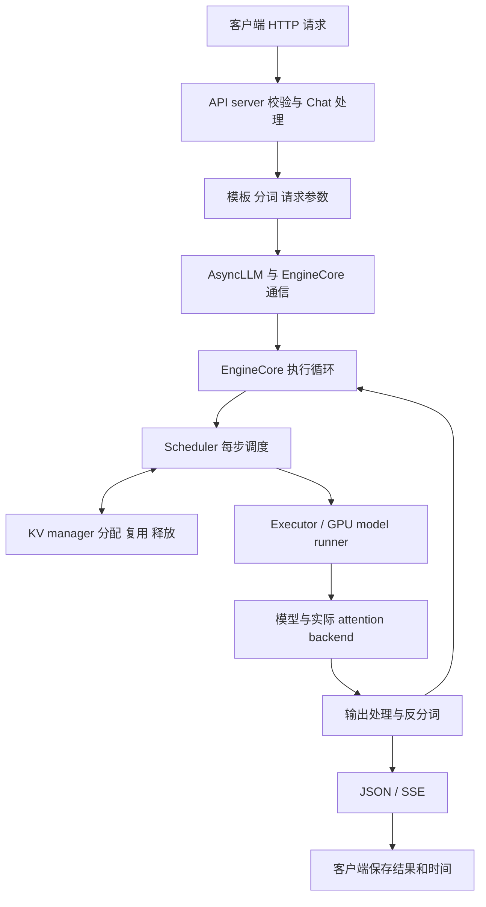

# W31：vLLM 服务、请求链路与测量基线

本周的中心是 **P3 服务 demo + 一条请求的执行过程**。API 是可观察的入口，源码阅读用于解释行为，基线用于检验理解。本周完成后，应能从客户端请求讲到 GPU 执行，再讲回 SSE 输出，并能说明每个指标究竟测了什么。

W31 是原计划中的学习进度编号；本轮按 20 小时推进，不因为原计划日期已经过去而跳过基础。尚未在 GPU 上完成的项目一律保持“待实测”。

## 1. 学什么，学到哪里

| 主题 | 必须理解的内容 | 本周实践与自测问题 |
| --- | --- | --- |
| Prefill／decode | prefill 处理输入并建立 KV；decode 逐步扩展序列并读取已有 KV | 为什么长输入常影响首输出等待，长输出常影响请求总耗时？ |
| 模型与 tokenizer | 本地权重目录、模型 alias、API served name、dtype、量化方法、tokenizer／chat template | `qwen3-8b-awq` 权重别名与 API 的 `qwen3-8b` 为什么可以不同？ |
| Chat API | 监听地址与目标地址；`/health`、`/v1/models`、`/v1/chat/completions`；messages、model、stream、usage | 如何从 Windows 区分网络连通性、模型名称错误、模板错误和生成失败？ |
| 生成控制 | thinking、temperature、top_p、top_k、seed、max_tokens | 固定参数后，为什么仍不应直接宣称跨环境严格逐 token 可复现？ |
| SSE 协议 | `data:` 事件、空行边界、增量文本、结束原因、`[DONE]`、usage 事件 | role／空文本／usage 事件会不会被误计成首 token？ |
| API server | 请求校验、协议对象、模板与分词、把生成结果封装成 JSON 或 SSE | 哪些工作在服务前端完成？ |
| Engine | 请求生命周期、异步输入和输出、EngineCore、进程间通信边界 | “提交生成请求”为什么不同于“立即执行一次模型 forward”？ |
| Scheduler／KV manager | 等待与运行请求、每步 token 预算、KV block 的分配和释放 | HTTP 并发、`max_num_seqs`、每步 token 数为什么是三个不同概念？ |
| Model runner／backend | 准备批次、执行模型、采样、实际 attention 实现的选择 | 从哪里确认本机实际 backend？能否仅凭安装 FlashInfer 推断正在使用它？ |
| 测量与复现 | TTFT、TPOT、请求时延、吞吐、分位数、失败、预热、重复 | 同一数值是否给出测量边界、样本数和原始证据？ |

本周需要识别 continuous batching、paged KV、chunked prefill、prefix caching、CUDA Graph 的作用，但暂不做全面调参，也不深入 kernel 内部实现。W32 再围绕混合负载逐项实验；后续 FlashInfer 章节再连接 kernel 证据。

## 2. 以一条请求组织架构知识

这是职责与数据流示意，并非每个箭头都是同一进程里的直接调用。源码中要同时辨认请求对象、调度结果、输出对象及进程通信边界。[官方架构总览](https://docs.vllm.ai/en/v0.14.1/design/arch_overview/)

建议拿同一个 request id 做一页笔记，依次回答：

1. HTTP JSON 在哪里被校验？API 名称如何匹配已服务模型？
2. messages 在哪里应用模板、变成 token？thinking 如何影响模板？
3. 生成任务如何加入 EngineCore？前端等待的是什么？
4. scheduler 本步决定哪些请求、多少 token？KV 分配不足时有什么分支？
5. model runner 如何接收本步工作？实际 attention backend 在哪里接入？
6. 输出何时结束？`finish_reason`、usage、SSE 终止如何传回客户端？

不必第一遍读完所有继承关系。先写出模块职责、主要输入输出、下一跳，再回到自己的 demo 验证一个观察。

## 3. 官方阅读与源码入口（锁定 v0.14.1）

本项目通过本地 `requirements-server.txt` 锁定 vLLM **0.14.1**，使用带版本的文档和 tag；不要直接把 `/en/latest/` 的参数或源码套入此环境。运行前仍需核验实际安装版本。官方页面和下列源码路径已按该版本核对。

| 阅读材料 | 本周阅读目标 |
| --- | --- |
| [OpenAI-Compatible Server](https://docs.vllm.ai/en/v0.14.1/serving/openai_compatible_server/) | 找到 Chat API、模板与额外生成参数的传递方式 |
| [Architecture Overview](https://docs.vllm.ai/en/v0.14.1/design/arch_overview/) | 理清前端、引擎、worker、模型之间的关系 |
| [V1 Guide](https://docs.vllm.ai/en/v0.14.1/usage/v1_guide/) | 了解 V1 的执行方式与适用范围 |
| [Optimization and Tuning](https://docs.vllm.ai/en/v0.14.1/configuration/optimization/) | 本周查概念和配置含义；参数消融留到 W32 |

| 源码入口 | 先搜索的符号／内容 | 阅读后留下的证据 |
| --- | --- | --- |
| [`entrypoints/openai/api_server.py`](https://github.com/vllm-project/vllm/blob/v0.14.1/vllm/entrypoints/openai/api_server.py) | `create_chat_completion`、`StreamingResponse` | API 到 Chat handler 的调用点 |
| [`entrypoints/openai/serving_chat.py`](https://github.com/vllm-project/vllm/blob/v0.14.1/vllm/entrypoints/openai/serving_chat.py) | `create_chat_completion`、stream／full generator | messages、生成器与响应封装关系 |
| [`v1/engine/async_llm.py`](https://github.com/vllm-project/vllm/blob/v0.14.1/vllm/v1/engine/async_llm.py) | `generate`、`add_request`、output handler | 请求加入与异步输出两个方向 |
| [`v1/engine/core.py`](https://github.com/vllm-project/vllm/blob/v0.14.1/vllm/v1/engine/core.py) | EngineCore、调度与执行调用 | 引擎循环如何推进生成 |
| [`v1/core/sched/scheduler.py`](https://github.com/vllm-project/vllm/blob/v0.14.1/vllm/v1/core/sched/scheduler.py) | `schedule`、等待队列、token 预算 | 本步工作如何形成 |
| [`v1/core/kv_cache_manager.py`](https://github.com/vllm-project/vllm/blob/v0.14.1/vllm/v1/core/kv_cache_manager.py) | `allocate_slots`、释放、缓存查询 | KV block 生命周期 |
| [`v1/worker/gpu_model_runner.py`](https://github.com/vllm-project/vllm/blob/v0.14.1/vllm/v1/worker/gpu_model_runner.py) | 模型执行、attention metadata、采样 | 调度结果如何进入模型 |

这些源码入口用来定位职责，不能替代本机启动日志和 profiler 证据。attention backend 会受版本、设备、dtype、模型结构和配置影响；本周记录实际日志，不预设 FlashInfer、FlashAttention 或其他实现。

## 4. 本周步骤与 20 小时分配

| 阶段 | 时间 | 顺序与操作 | 验收 |
| --- | ---: | --- | --- |
| A：环境与概念 | 2h | 核验本项目 GPU 环境、vLLM 版本、模型目录；复习 prefill／decode／KV；检查服务 dry-run | 环境信息和启动参数能解释 |
| B：单次 API | 3h | 重启 Linux 服务；从 Windows 检查 TCP、健康与模型列表；非流式调用；比较 `max_tokens` 小／大两种情况 | 原始响应、usage、结束原因保留 |
| C：流式客户端 | 3h | 运行 SSE；观察空事件、文本事件、usage、结束事件；理解异常与超时 | 可即时显示，能说明 TTFT 起止点 |
| D：源码链路 | 5h | 沿请求依次读 API、AsyncLLM、EngineCore、scheduler／KV、runner | 一页请求链路图和源码索引 |
| E：固定基线 | 5h | 小批量冒烟；三类请求 × 并发 1／4；预热 2 次、每组 20 请求、重复 3 轮 | 原始 JSONL、每轮汇总，无静默丢弃错误 |
| F：解释与报告 | 2h | 重算汇总，核对分位数有效样本；填写报告与复现步骤 | 能解释观察及当前测量限制 |
| 合计 | **20h** | | |

当前本机 Python 3.13.5，未安装 vLLM，真实 GPU 服务仍待验证。如果 GPU 环境尚未准备好，先完成 A 的配置核验、C 的模拟测试、D 的源码阅读和 F 的报告框架；B／E 必须保留待实测状态。只在真实服务可运行后填写性能数值。

## 5. 从已有代码开始学习

| 文件 | 阅读重点 | 本周动作 |
| --- | --- | --- |
| P3 `scripts/serve.py` | 配置校验、版本约束、命令构建、实际执行与 dry-run | 把命令中每个服务参数写成一句话 |
| `scripts/model_config.py` | 本地模型 alias、MODEL_ROOT、模型配置、精度与量化校验 | 将本地权重映射为明确的 vLLM 参数 |
| `scripts/http_client.py` | 标准库 HTTP／SSE 传输、usage、认证与异常 | 读懂独立客户端的协议处理 |
| `scripts/common.py` | 请求参数、文本事件测量、逐请求记录、汇总口径 | 对照一条 metrics 记录解释每个字段 |
| P3 `scripts/client.py` | 单请求、即时文本输出、请求结果保存 | 跑一次非流式和一次流式 |
| P3 `scripts/benchmark.py` | 预热、worker 并发、每轮计时、失败记录 | 将 case 与结果逐项对上 |
| P3 `scripts/summarize.py` | 从 metrics／cases 重算、分位数、吞吐分母 | 用原始记录复算一个 case |

本项目的服务启动直接使用 `python -m vllm.entrypoints.openai.api_server`，学习和运行所需脚本、配置及服务依赖清单全部位于本目录。完整命令在 [README](../README.md)。客户端默认生成控制沿用代码中的固定值，本周以 thinking off 和短输出先跑通，再固定负载。修改 thinking、dtype、精度、模板或输出预算会改变工作量，不能在比较中悄悄更换。

### Windows 到 Linux 的服务链路

本周部署约定：Linux 服务监听 **`0.0.0.0:7081`**，Windows 客户端默认连接 **`http://192.168.88.91:7081`**。`0.0.0.0` 是服务器绑定地址；客户端目的地址必须是服务主机的可达 IP。配置修改后要重启服务；本机模拟测试的 loopback 服务不等于此远程部署。

按顺序验证，每一步只回答一个问题：

1. `Test-NetConnection 192.168.88.91 -Port 7081`：Windows 能否建立 TCP 连接？
2. `Invoke-RestMethod` 调用 `/health` 和 `/v1/models`：HTTP 服务是否可用，API 模型名称是什么？
3. 本地 `scripts/client.py --stream --no-proxy`：是否能立即看到远程 SSE 文本增量？
4. 本地 `scripts/benchmark.py --concurrency 1 2 --requests-per-workload 2 --warmup 1 --repeats 1 --no-proxy`：小规模并发和结果落盘是否成功？

Windows 的客户端和压测仅需 Python 标准库，无需安装 GPU 运行时；认证沿用现有 `VLLM_API_KEY` 环境变量。完整 PowerShell 命令和绝对路径见 [README 的远程访问步骤](../README.md#在-windows-访问远程-gpu-服务)。若 Linux 在容器内，需确认已有启动命令包含端口发布，如 `-p 7081:7081`。无法连通时分层检查监听、容器端口、路由和防火墙；本项目不会自动修改网络配置。
## 6. 固定配置与负载设计

基线配置是起点，不是最优配置：

| 配置 | 本周起点 | 为什么记录 |
| --- | --- | --- |
| 模型／版本 | Qwen3-8B，vLLM 0.14.1 | 保证源码、参数和测量对应 |
| 监听／客户端地址 | 服务 `0.0.0.0:7081`；客户端 `http://192.168.88.91:7081` | 绑定地址与请求目的地址分别记录 |
| dtype／量化 | 本地 BF16 权重；必要时核验 AWQ W4A16 并单独建立基线 | 权重内存和执行路径不同 |
| max_model_len | 2048 | 输入加生成预算不能超上下文边界 |
| max_num_seqs | 4 | 引擎每步可调度序列上限，与 HTTP 并发不同 |
| eager | 开 | 先建立易理解的执行基线 |
| prefix caching | 关 | 本周不把前缀缓存收益混入基础对比 |
| chunked prefill | 开 | 固定并记录，W32 再调度消融 |
| 客户端并发 | 1、4 | 观察基础排队／吞吐变化，不据此做容量承诺 |

负载文件是三条真实中文 prompt，覆盖“短输入短输出”“较长输入短输出”“短输入较长输出”。名称是相对场景描述，**并非精确 token 长度标定**。中文字符数、UTF-8 字节数和 tokenizer token 数不能互换；实际长度看 API `usage`。`max_tokens` 只控制生成上限，输出可能提前结束。

本周各场景分开测量，适合建立可解释基线。W32 再把长短请求混合，并按请求类别分别统计，以免总体分位数掩盖短请求退化。

## 7. 指标、口径与解释边界

记 `t0` 为请求开始，`tfirst` 为首个非空文本 SSE 事件到达，`tlast` 为末个文本事件到达，`tend` 为响应读取完成，`Nout` 为服务 usage 中的输出 token 数。

- **请求时延**：`tend - t0`；包含客户端可见的网络、排队、服务与接收开销。
- **TTFT 近似值**：`tfirst - t0`；是首个文本输出事件，不保证等于首个模型 token 完成时间。
- **TPOT 近似值**：有可靠输出计数且 `Nout > 1` 时，按 `(tlast - tfirst) / (Nout - 1)` 估算；缺少条件时留空。
- **输出吞吐**：本 case 成功请求的实际输出 token 总数／本 case 测量墙钟窗口。窗口含失败请求花费，排除预热；若成功输出计数缺失，吞吐应保留缺失或显式标注不完整。
- **请求吞吐**：成功请求数／相同窗口墙钟时间。
- **错误率**：失败数／全部测量请求数。超时、HTTP 错误、协议错误等应留下记录。

首／末文本事件和 token 并非一一对应；一次 SSE 事件可以携带多个 token。上述 TPOT 只是客户端文本事件近似值，不能当作逐 token GPU ITL，文本事件间隔也不能直接解释为 attention kernel 执行时间。非流式请求只有完成时刻，TTFT／TPOT 应为空。

p50 与 p95 应分别针对 TTFT、TPOT、总耗时计算，同时记录各自有效样本数。当前按 nearest-rank 方法对成功请求中的有效值汇总，失败由错误率单独体现。每组仅 20 个请求时 p95 对少量样本很敏感，适合教学基线，不适合作服务等级承诺。

每个 **负载 × 并发 × 重复轮次** 是一个独立 case。保留三轮结果再解释波动，不能把三个轮次的 tokens/s 相加，也不能把三个场景的 p95 平均后称为整体 p95。线程池并发实验也不是按固定到达率驱动的真实线上流量。

本项目直接使用 vLLM 官方服务响应，当前指标全部在客户端观测。客户端计时不能当作纯 GPU 时间；排查 kernel 瓶颈需要后续 profiler 证据。

## 8. 完成标准与下一周边界

本周完成必须同时满足：

- [ ] 真正加载目标模型；服务环境、精度和实际 backend 已记录。
- [ ] 非流式／流式均成功，原始内容、usage、finish_reason、错误已保存。
- [ ] 能从 API server 讲到调度、KV 与 runner，再解释输出如何回来。
- [ ] 固定三类负载，在并发 1／4 下完成预热和三轮基线。
- [ ] 从原始记录重算结果，并逐一解释缺失指标和小样本限制。
- [ ] 填写 [W31 报告](../reports/W31_Report.md)，能按命令复现。

`stop` 代表服务报告停止条件，可能来自 EOS 或显式 stop 条件；`length` 代表长度限制。若要证明命中具体 EOS token，应增加对应 token 证据；不能只看最终显示文字推断。

W32 的输入就是本周保存的配置、负载、原始记录和问题清单。下一周逐项研究 continuous batching、paged KV、chunked prefill、prefix caching、CUDA Graph 的取舍，目标是解释吞吐和尾延迟变化。
